# How Hearth works

A tour of the app, screen by screen, then how the pieces behind it fit together.

- [The screens](#the-screens)
- [How Hearth connects](#how-hearth-connects)
- [Where Hearth runs](#where-hearth-runs)
- [A tap, end to end](#a-tap-end-to-end)
- [How every screen stays live](#how-every-screen-stays-live)
- [The wall tablet](#the-wall-tablet-1)
- [Activity](#activity-1)
- [Who can open the home](#who-can-open-the-home)

## The screens

### Home

The dashboard is a grid you build yourself. It starts empty; **Add tile** picks what a tile is, **Edit** drags, resizes, and restyles, and the room tabs filter it. A tile's colour is the device's own colour while it is on: a light's glow, a fan's teal.

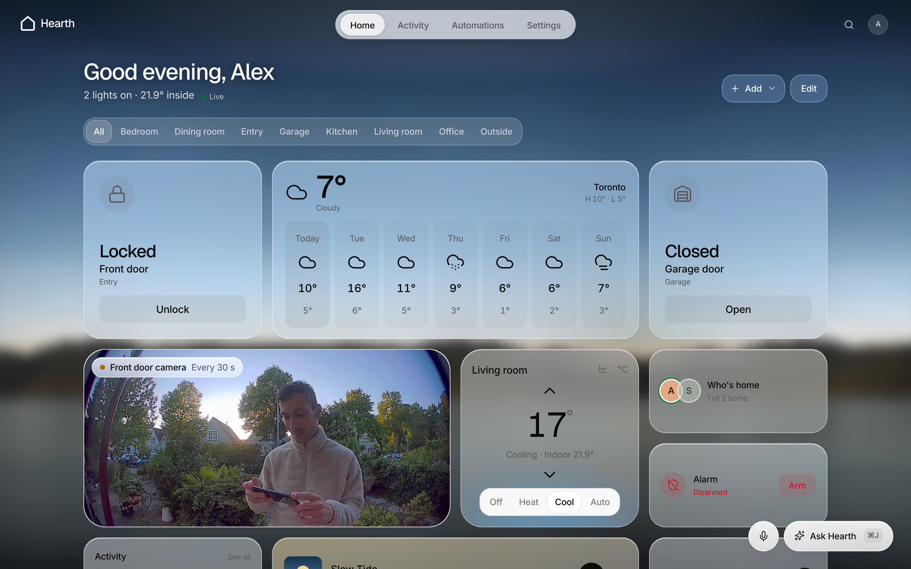

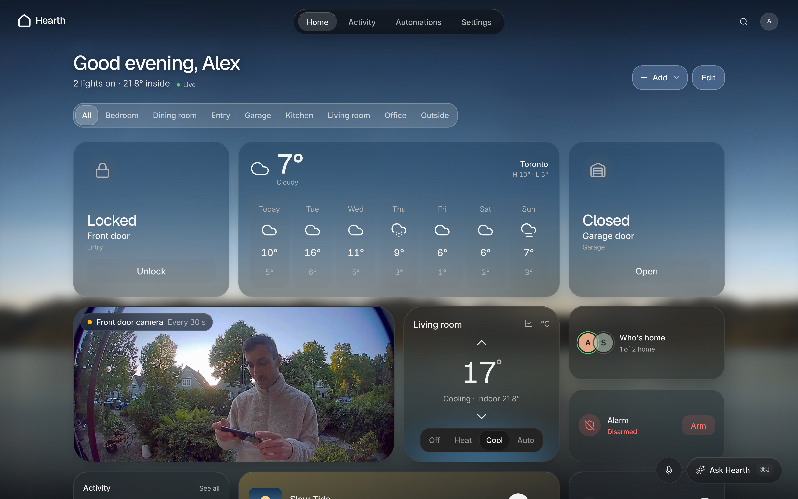

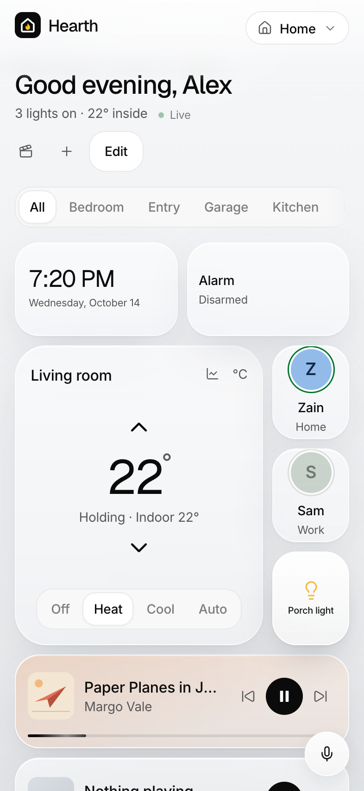

The things you reach for most sit one tap away: lights that dim and glow in their own colour, plugs, the front door, and the garage.

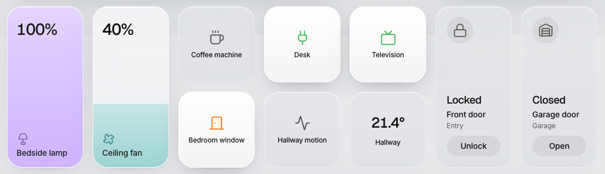

### Customize a tile

In **Edit**, each tile has a **Customize** button: its size, icon, colour, what press and hold does, and settings that belong to its kind. An on/off device can be shown as a light, a switch, or a fan, for a light switch Home Assistant files as a fan.

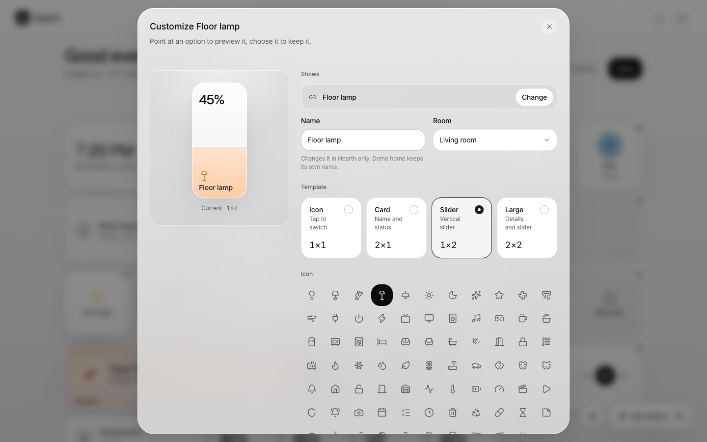

### Activity

Everything that happened at home, newest first, with who did it: a person, an automation, or a change made in Home Assistant's own app or at the switch on the wall.

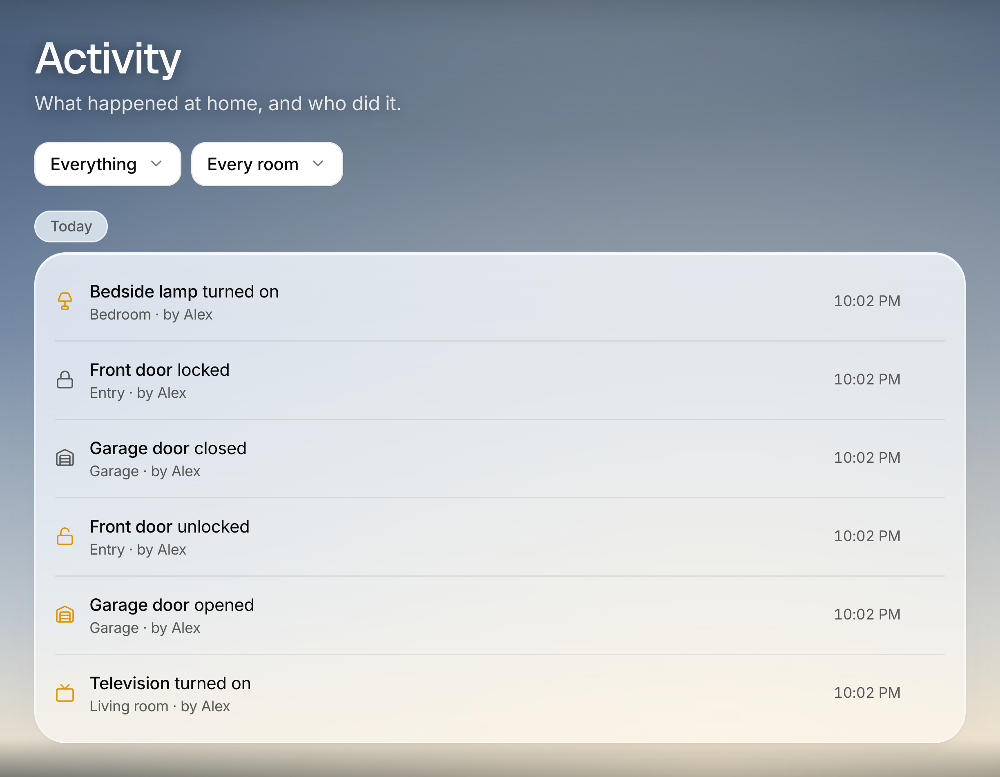

### Automations

When, only if, then: a time, sunrise or sunset, or a device changing; only after dark, between times, or while another device is in a state; then control devices, run a scene, or send an alert. Tap a rule to edit it, flip its switch to pause it, or snooze it from **…** for an hour, four hours, or until tomorrow.

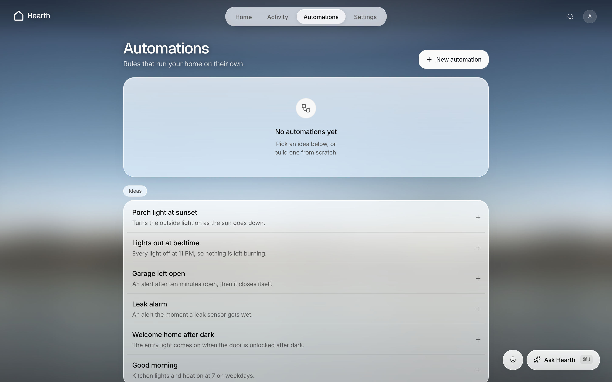

### The assistant and voice

**Ask Hearth** (or Cmd or Ctrl J) opens a chat; the microphone beside it starts listening straight away. Everyday requests ("dim the kitchen to 30%") go to the assistant you connect in Settings. While Hearth listens, a glow from [voice-glow](https://libraries.dev) rises with your voice.

### Settings

Connections, cameras, calendars, assistants, alerts, the household, the wall tablet, and how the home is opened.

### The wall tablet

Turn on **Settings, Wall tablet** on the tablet itself. It keeps the screen on and rests on the date over a large clock, in the colour and brightness you pick, turning a dim red at night if you like.

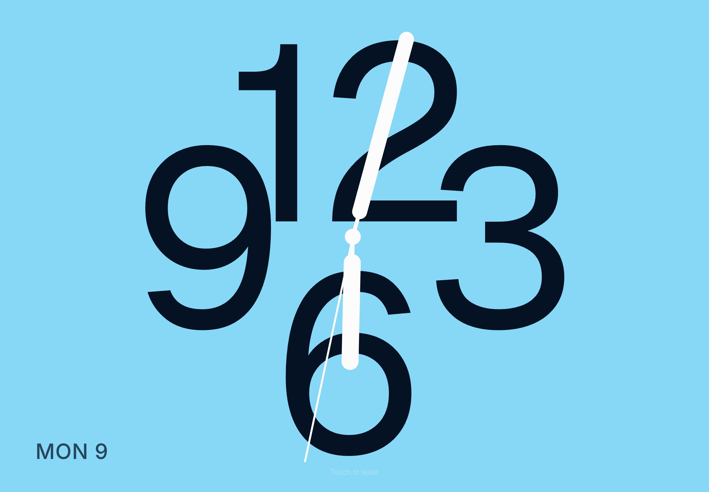

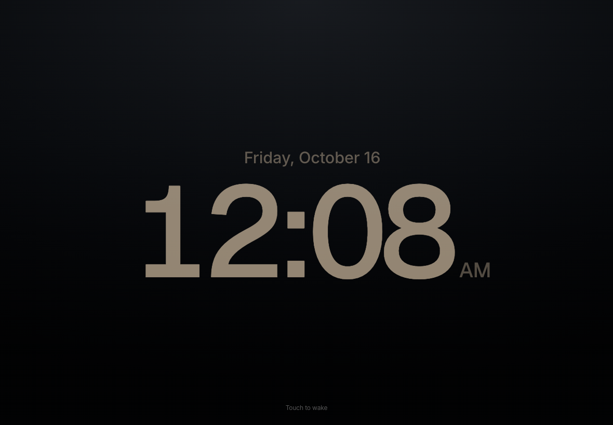

## How Hearth connects

Hearth is one Next.js app. Browsers talk only to Hearth; Hearth talks to everything else, so tokens and passwords never reach a browser.

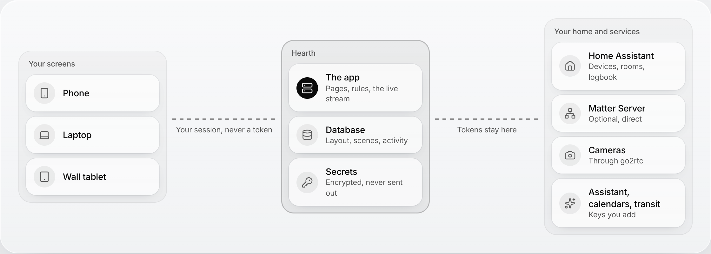

| Piece | What it does | Where it lives |
| --- | --- | --- |
| Pages and tiles | What you see and tap | `src/app`, `src/components` |
| API routes and server actions | Every read and write, each checking who you are first | `src/app/api`, `src/lib/actions.ts`, `src/lib/widget-actions.ts` |
| Providers | One adapter per integration, all speaking Hearth's `Device` and `DeviceCommand` | `src/lib/integrations` |
| Live bus | Tells open screens something changed | `src/lib/live/bus.ts`, `src/app/api/home/stream` |
| Home monitor | History, the activity log, alerts, and automations | `src/lib/monitor` |
| Postgres | Accounts, layouts, widgets, automations, encrypted secrets | `src/lib/db`, `drizzle/` |

## Where Hearth runs

The same code runs hosted or at home. The difference is whether a server stays awake between requests. Hosted on Vercel, Hearth reaches Home Assistant over the internet, so give Home Assistant a public address with a [Tailscale Funnel](https://tailscale.com/kb/1223/funnel) or Home Assistant Cloud.

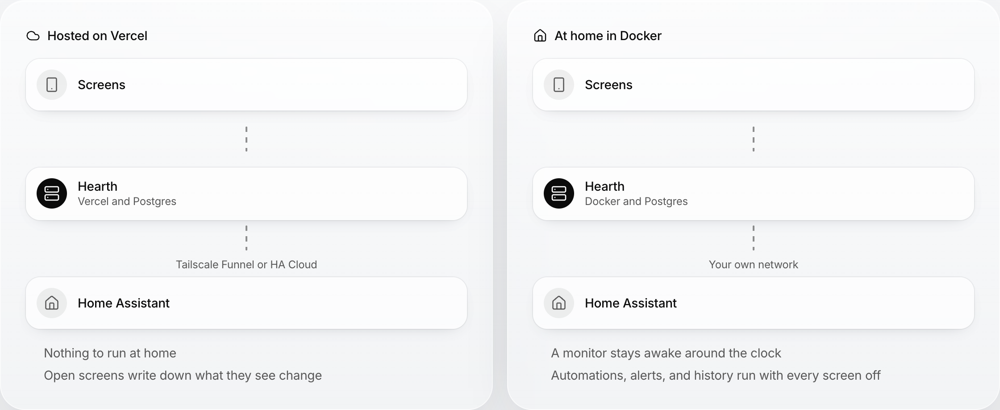

## A tap, end to end

Pressing a tile shows the change at once, then confirms it. If the device refuses, the tile goes back.

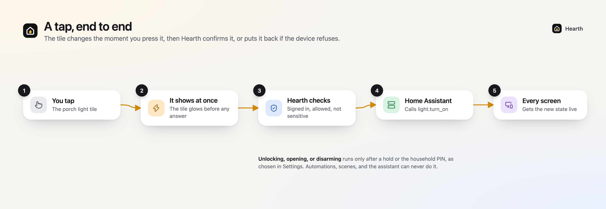

## How every screen stays live

Each page opens one Server-Sent Events stream, however many tiles it shows. When anything changes, the server rebuilds the home once and sends it to every open screen. A connection that misses one answer keeps its last devices on screen for two minutes before Hearth says it is not responding.

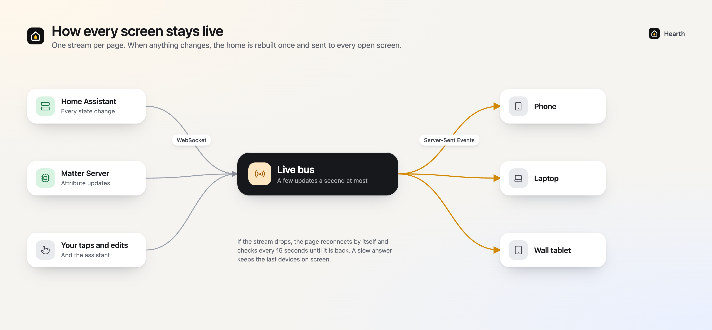

## The wall tablet

Wall tablet mode is a setting on the tablet itself, kept in that browser, because each tablet hangs somewhere different. While it rests, the clock drifts a few pixels each minute so nothing burns into the screen.

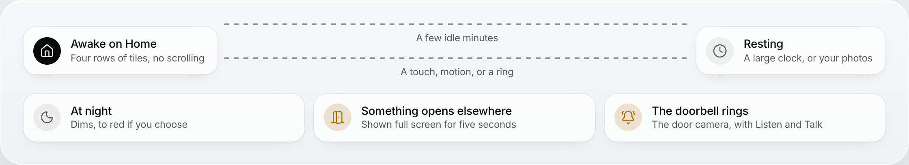

## Activity

On an always-on server, the monitor writes what changed into Hearth's own log, credited to whoever caused it. Home Assistant keeps a logbook too, of everything. Activity reads both and merges them, so it works on Vercel as well.

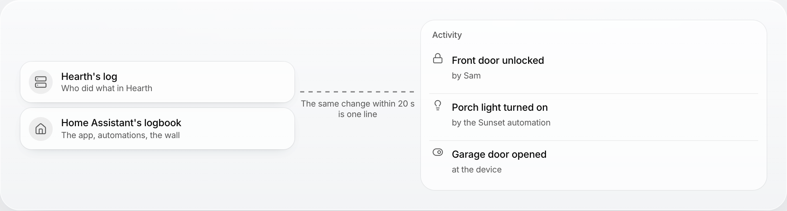

## Who can open the home

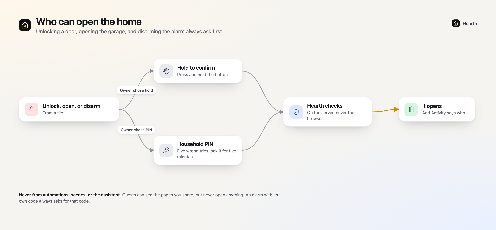

Guests can be given pages to see, but never unlock or open anything. Members share everything with the owner.
