# How Hearth works

A tour of the app, screen by screen, then how the pieces behind it talk to each other. The diagrams are [Mermaid](https://mermaid.js.org), which GitHub draws in place.

- [The screens](#the-screens)
- [The big picture](#the-big-picture)
- [Where Hearth runs](#where-hearth-runs)
- [A tap, end to end](#a-tap-end-to-end)
- [How every screen stays live](#how-every-screen-stays-live)
- [Widgets and household items](#widgets-and-household-items)
- [Timers, from a word to a ring](#timers-from-a-word-to-a-ring)
- [The wall tablet](#the-wall-tablet)
- [Activity](#activity)
- [Automations](#automations)
- [Who can open the home](#who-can-open-the-home)

## The screens

### Home

The dashboard is a grid you build yourself. It starts empty; **Add tile** picks what a tile is, **Edit** drags, resizes, and restyles, and the room tabs filter it. A tile's colour is the device's own colour while it is on: a light's glow, a fan's teal.

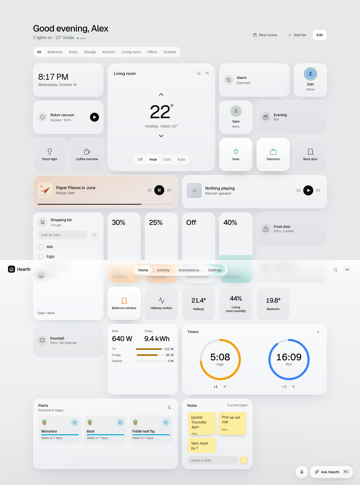

In **Edit**, each tile has a **Customize** button: its size, icon, colour, what press and hold does, and settings that belong to its kind, such as timer presets or an energy price.

### Household widgets

Widgets keep the things a household juggles: bins, medications, notes, plants, packages, Wi-Fi for guests, and timers. They save the moment you change them, so a note or a plant shows up straight away on every screen.

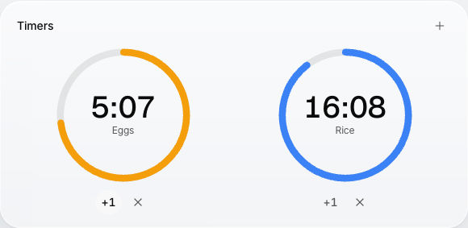

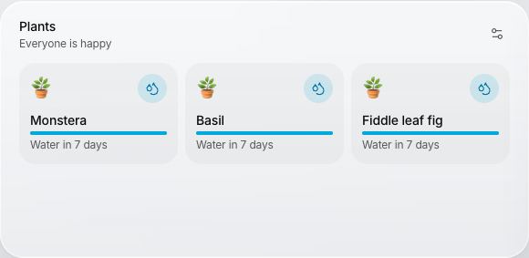

- **Timers**: one timer fills its tile as a dial. Two to four sit side by side, each in its own colour, and the dial itself starts and pauses. Presets ("Eggs, 7 min") are set once per tile under Customize and sit before the plain lengths.
- **Plants**: as many to a row as the tile is wide, thirstiest first. Tap the drop when you water one.
- **Medications**: what is left today first, missed doses flagged, and the supply counting down as doses are ticked off.

### Activity

Everything that happened at home, newest first, with who did it: a person, an automation, or a change made in Home Assistant's own app or at the switch on the wall.

### Automations

When, only if, then: a time, sunrise or sunset, or a device changing; only after dark, between times, or while another device is in a state; then control devices, run a scene, or send an alert. Tap a rule to edit it, flip its switch to pause it, or snooze it from **…** for an hour, four hours, or until tomorrow.

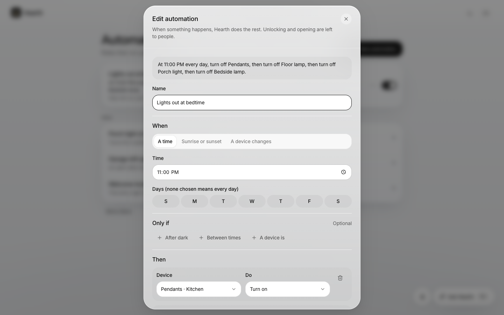

### The assistant and voice

**Ask Hearth** (or Cmd or Ctrl J) opens a chat; the microphone beside it starts listening straight away. "Set a 10 minute timer for the pasta" works on the device itself, with no AI key. Everything else ("dim the kitchen to 30%") goes to the assistant you connect in Settings. While Hearth listens, a glow from [voice-glow](https://libraries.dev) rises with your voice.

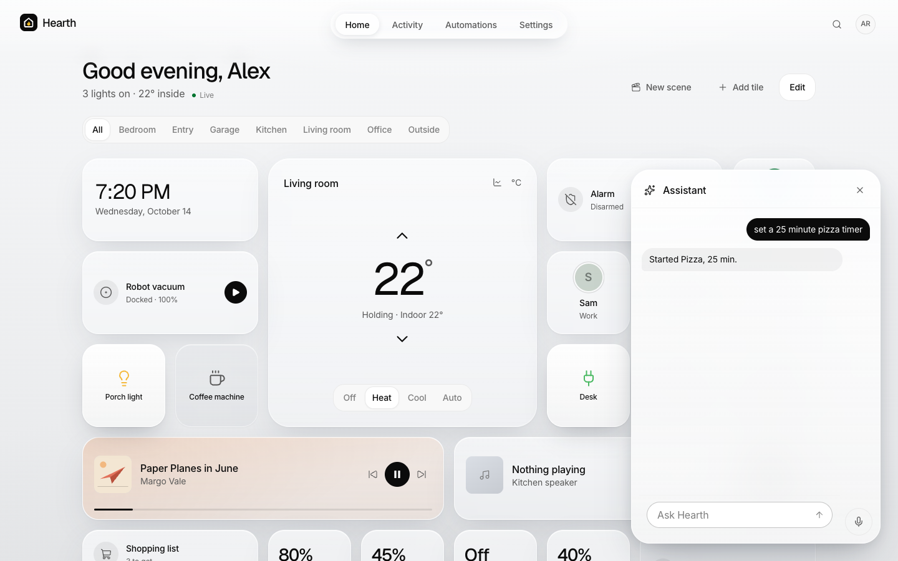

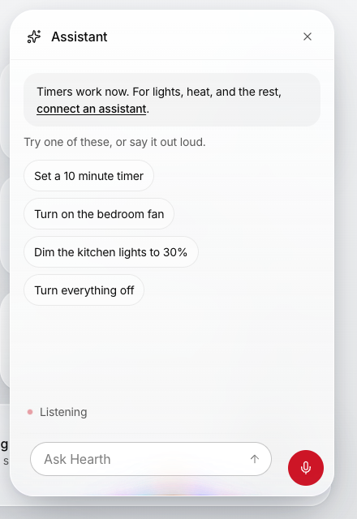

### Settings

Connections, cameras, calendars, assistants, alerts, the household, the wall tablet, and how the home is opened.

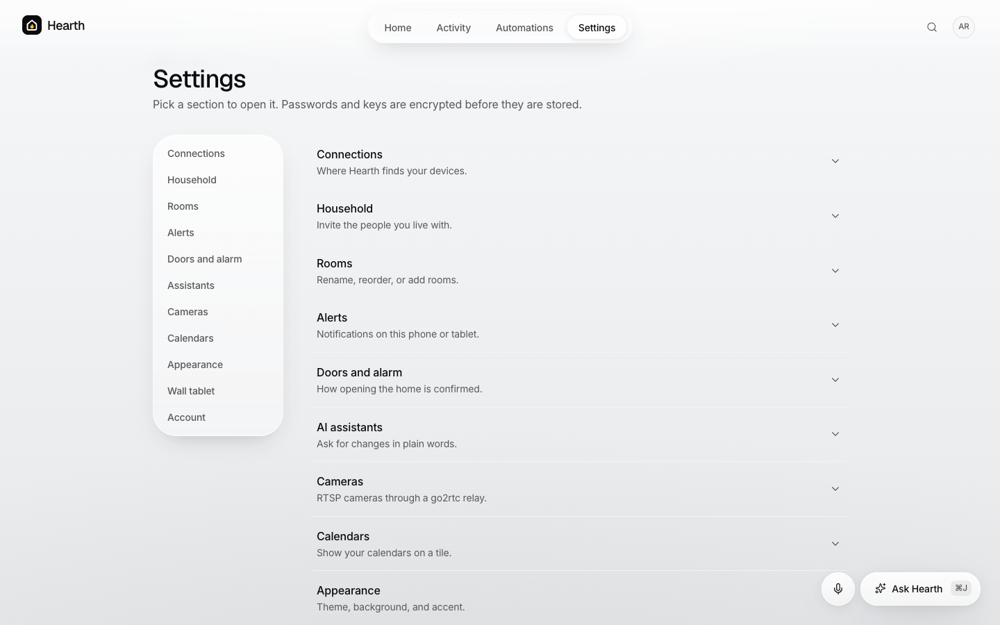

### The wall tablet

Turn on **Settings, Wall tablet** on the tablet itself. It keeps the screen on, rests on the date over a large clock with the running timers and what needs doing next as cards, turns a dim red at night, and brings a finished timer up over everything.

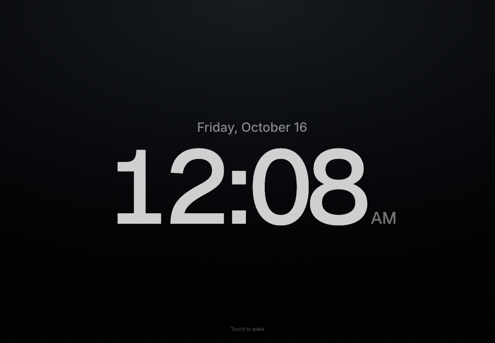

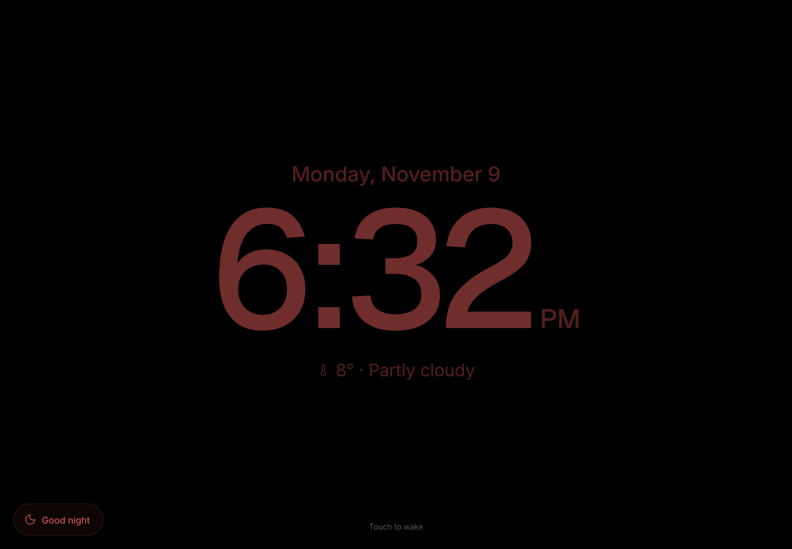

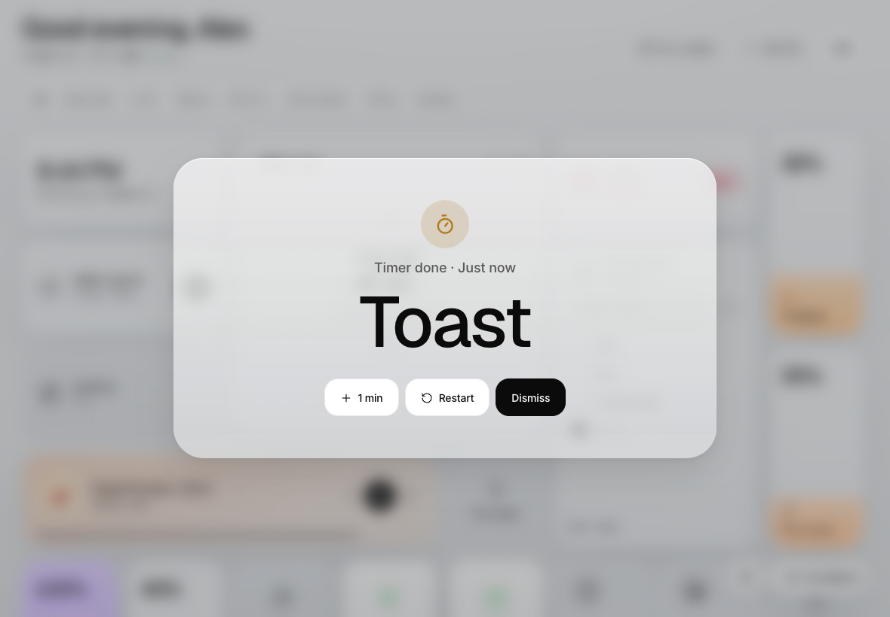

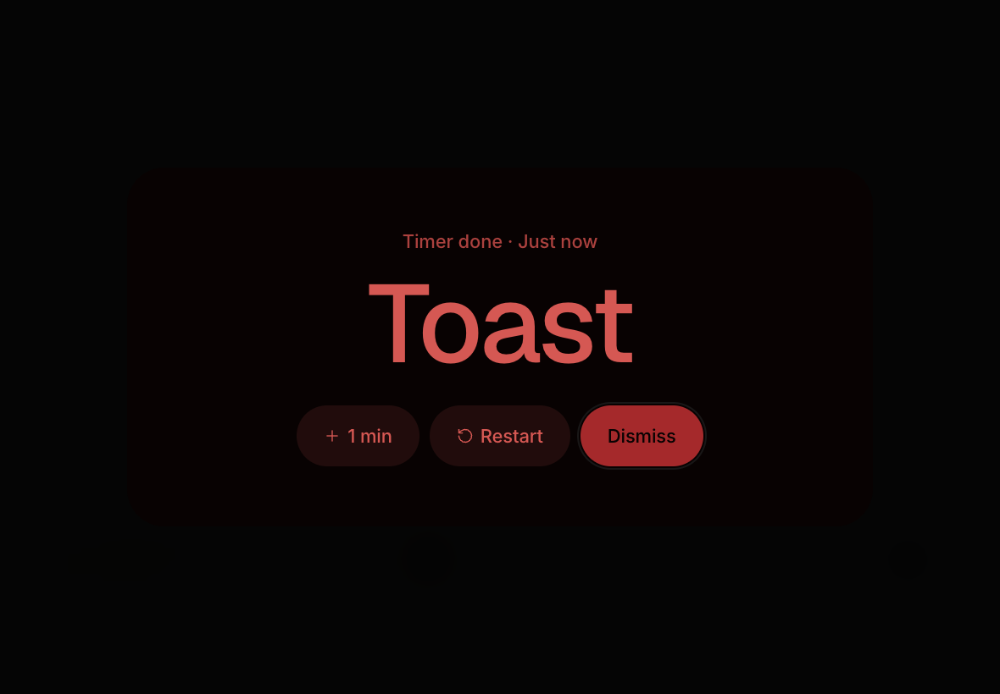

## The big picture

Hearth is one Next.js app. Browsers talk only to Hearth; Hearth talks to everything else, so tokens and passwords never reach a browser.

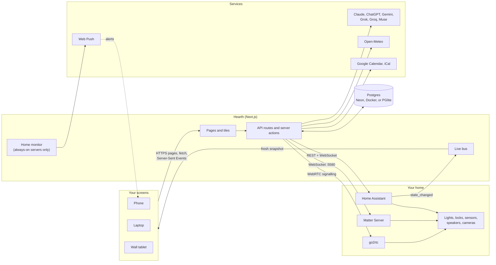

| Piece | What it does | Where it lives |
| --- | --- | --- |
| Pages and tiles | What you see and tap | `src/app`, `src/components` |
| API routes and server actions | Every read and write, each one checking who you are first | `src/app/api`, `src/lib/actions.ts`, `src/lib/widget-actions.ts` |
| Providers | One adapter per integration, all speaking Hearth's `Device` and `DeviceCommand` | `src/lib/integrations` |
| Live bus | Tells open screens something changed | `src/lib/live/bus.ts`, `src/app/api/home/stream` |
| Home monitor | History, the activity log, alerts, and automations | `src/lib/monitor` |
| Postgres | Accounts, layouts, widgets, automations, encrypted secrets | `src/lib/db`, `drizzle/` |

## Where Hearth runs

The same code runs in two shapes. The difference is whether a process stays up between requests.

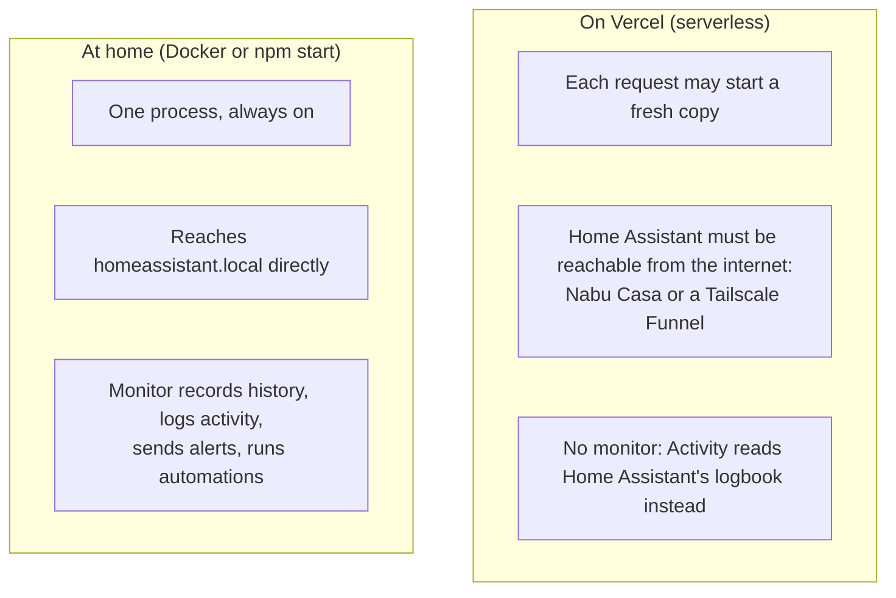

| | Vercel | Always-on server |
| --- | --- | --- |
| Dashboard, controls, widgets, timers, voice | Yes | Yes |
| Activity | From Home Assistant's logbook | Hearth's own log and Home Assistant's, merged |
| Automations, alerts, sensor history | No | Yes |
| Reaching Home Assistant | A public address | The local address |

On Vercel, Hearth's servers call Home Assistant from the internet, so `http://homeassistant.local:8123` cannot work. A [Tailscale Funnel](https://tailscale.com/kb/1223/funnel) gives Home Assistant a public HTTPS address without opening a port on your router:

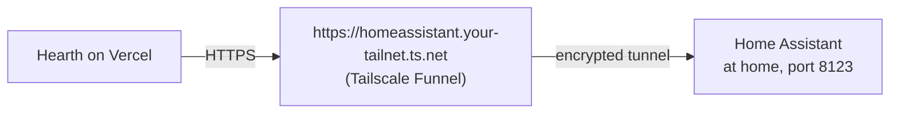

## A tap, end to end

Pressing a light tile shows the change at once, then confirms it. If the device refuses, the tile rolls back.

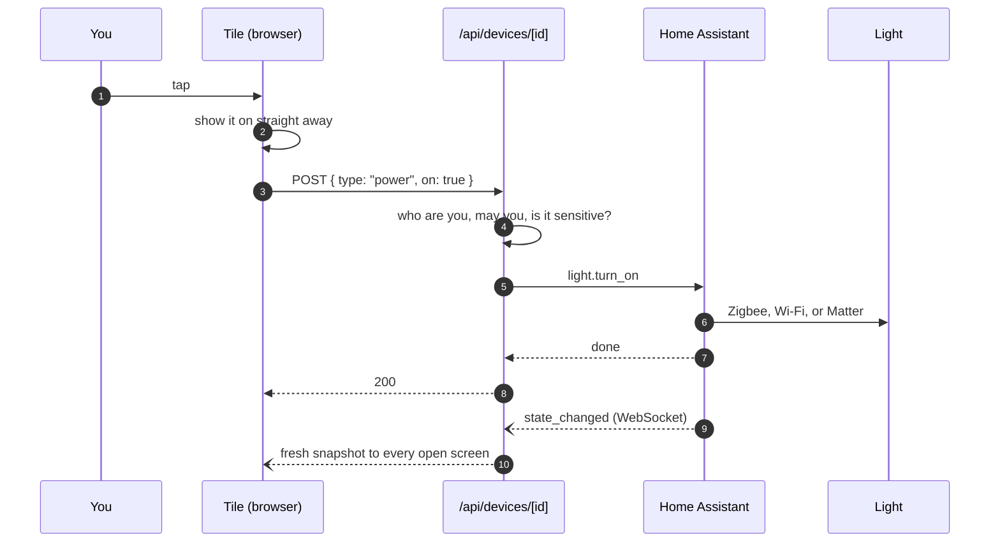

Unlocking a door, opening a garage, and disarming the alarm are **sensitive**: the server only runs them after a hold to confirm or the household PIN, as the owner chose in Settings. Automations, scenes, and the assistant can never run them.

## How every screen stays live

Each page opens **one** Server-Sent Events stream, however many tiles it shows. When anything changes, the server rebuilds the home once and sends the new snapshot to every open screen.

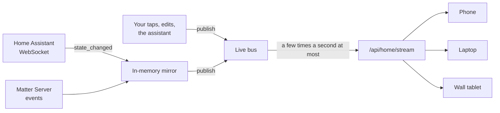

If the stream drops, the browser reconnects by itself and checks every 15 seconds until it is back. A pushed snapshot waits while one of your own taps is still on its way, so a switch never flickers back.

## Widgets and household items

Notes, plants, medications, timers, and the rest are rows in one table, `widget_item`, each checked against its kind's schema on every write (`src/lib/widgets/items.ts`). A Wi-Fi password is sealed before it is stored.

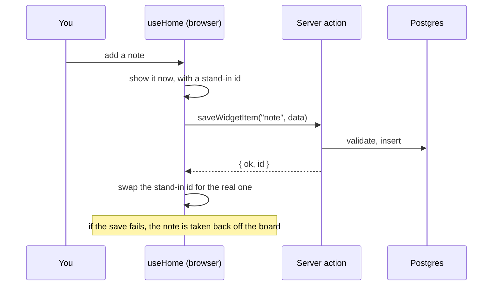

## Timers, from a word to a ring

A timer is a row with an end time, so every screen counts down to the same moment and a timer keeps running with every screen closed.

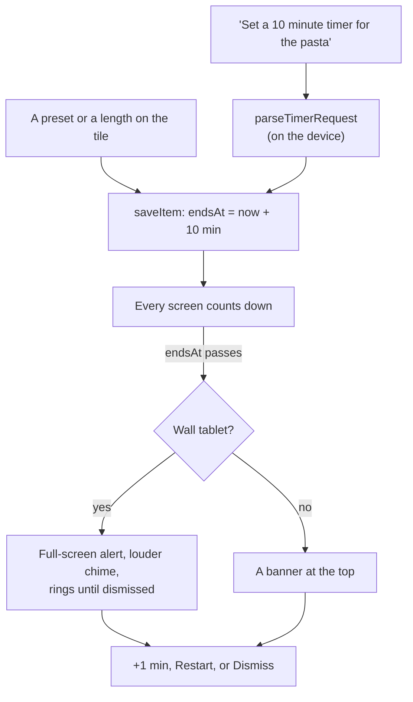

Voice uses the browser's own speech recognition. Timer requests never leave the device; anything else goes to the assistant.

## The wall tablet

Wall tablet mode is a setting on the tablet itself, kept in that browser, because each tablet hangs somewhere different.

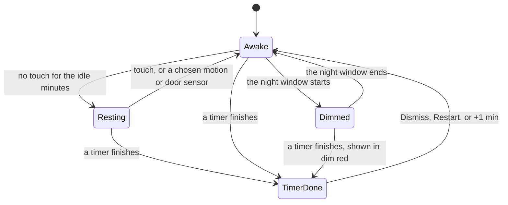

While it rests, the clock drifts a few pixels each minute so nothing burns into the screen, and running timers sit under it. It asks the browser to keep the screen on.

## Activity

On an always-on server, the monitor writes what changed into Hearth's own log as it happens, credited to whoever caused it. Home Assistant keeps a logbook too, of everything: the app, its automations, the switch on the wall. Activity reads both and merges them, so it works on Vercel as well.

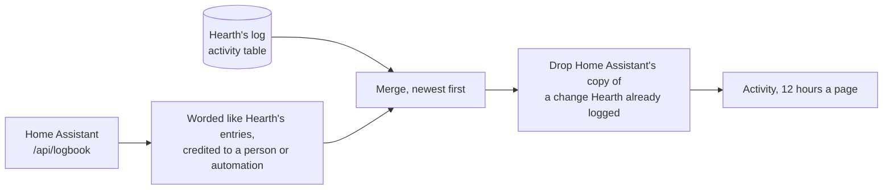

## Automations

The monitor checks device rules on every change and clock and sun rules every 30 seconds. A snoozed rule is skipped until its time passes, then runs again by itself; a scheduled time that fell inside the snooze is not caught up.

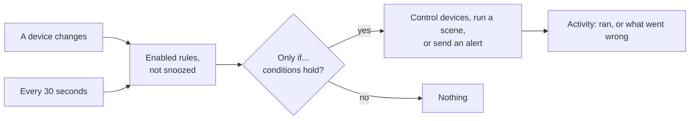

## Who can open the home

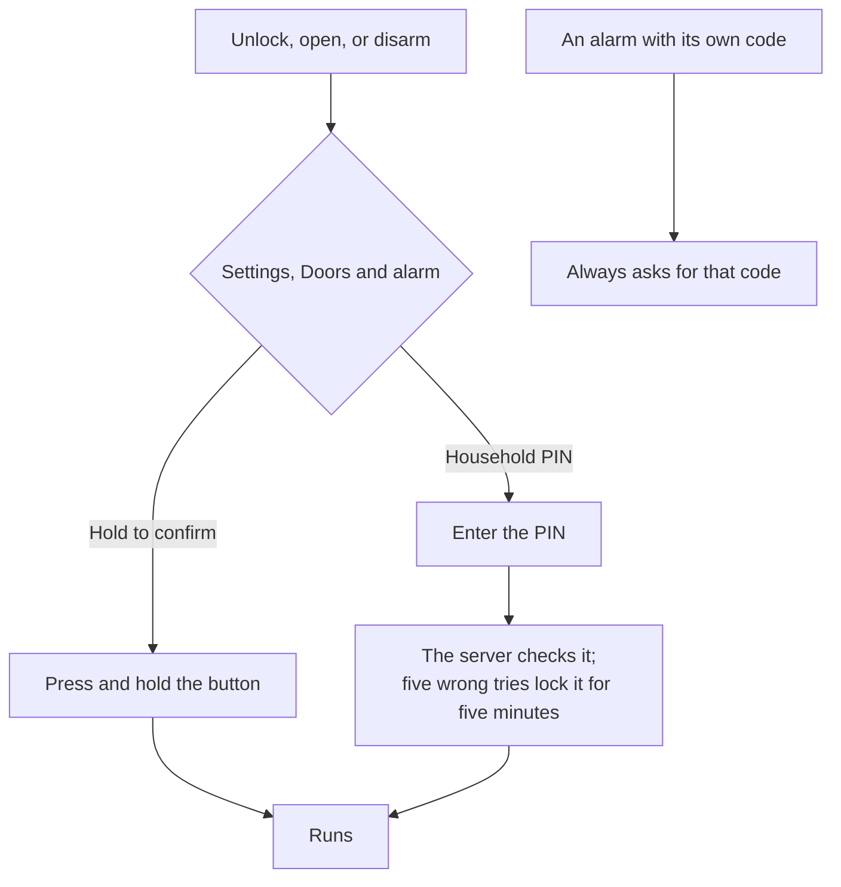

Guests can be given pages to see, but never unlock or open anything. Members share everything with the owner.
